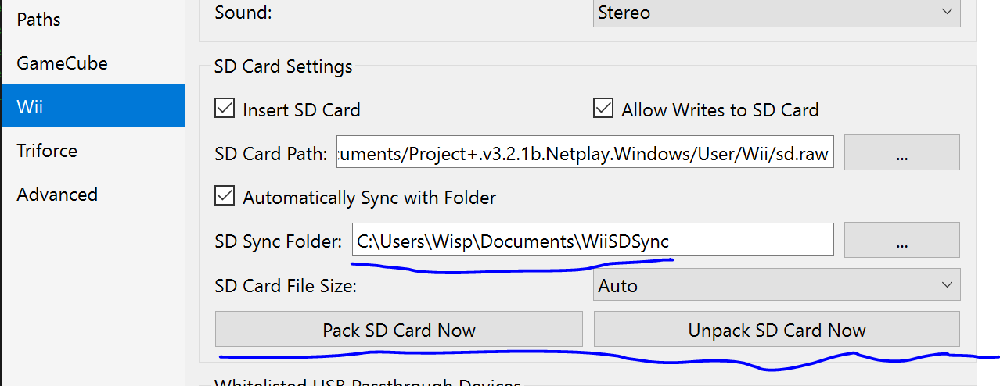

# Project Punch

Project Punch is a mod for Project+ that extends the Training Mode with more labbing tools.
Adds frame advance, color overlays, a ledgedash HUD, OSDs, and more!

# Installing
[Download Project Punch from the latest release](https://github.com/WispSSBM/ProjectPunch/releases). Then,
copy the `Project+` folder onto your SD card root. On emulator, you can access the SD card by opening the 
general settings, going to the Wii tab, and unpacking the SD card to a directory. Remember to re-pack the SD card
once you're done modifying the files! 



# Built with Syriinge
This is an implementation of a [Syriinge](https://github.com/Sammi-Husky/Syriinge) plugin to be used in Super Smash Bros. Brawl. It is made with syriinge in This repository is already set up to use the [BrawlHeaders](https://github.com/Sammi-Husky/BrawlHeaders) repository which includes many if not most in game functions you will need to use in your plugins.

# Requirements
- DevKitPro

# Building
To build, simply run `make` on the command line.

To generate the external action-name binary, run:

```sh
python tools/pack_actions.py
# Or choose an output path:
python tools/pack_actions.py path/to/actions.bin
```

The script stores action IDs and names in its `ACTIONS` dictionary literal.
Edit that dictionary to update the list. The default output is
`build/actions.bin`. It contains a headerless, big-endian `u16` offset table
followed by null-terminated ASCII strings. Identical names share an offset;
missing IDs have offset `0xFFFF`. Offsets are relative to the start of the
string data.

The table length is the highest action ID in `ACTIONS` plus one: currently `0x11F`
entries (574 bytes), including action `0x11E`. The runtime loader must use this
same length to locate the strings. Use `--count 0x120` to explicitly choose a
different table length (update the runtime count to match). Copy the generated
file to `sd://pf/ppunch/actions.bin`. The game loads it once at startup; missing
or invalid files and unnamed IDs display `UNLABELED`.

